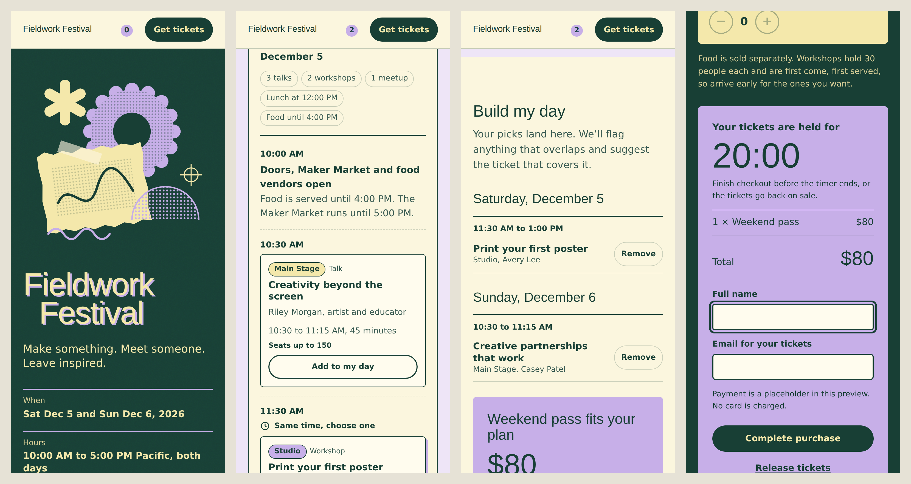

# Fieldwork Festival

Arrived Design Partner Application, Option 2: Fieldwork Festival concept exercise.
Submitted by Alexis Johnson.

## Links

- Builder version: http://fieldwork-festival-6.happily.events/
- Improved version: https://claude.ai/artifact/9mDwsYGC5iPoh4eb6vZj1T
- Source for the improved version: [`index.html`](index.html) (open it in any browser)

## Mobile preview

The screenshots use a fallback font; the live page uses a poster-style display font.

## Key features

- **Visual design:** Blends riso print with cut-paper collage, including an offset lilac "misprint" shadow on the text wordmark. The hero features a scalloped halftone sun, a torn butter-paper scrap with tape and a registration mark, with torn paper edges separating sections. All visuals are original SVGs in the brief's Forest, Butter and Lilac palette, with light and dark mode support.
- **Schedule view:** Saturday and Sunday sit side by side, switching to a day toggle on mobile. Each day has a summary (talks, workshops, lunch time and food hours). Concurrent sessions are paired and labeled "Same time, choose one," and visitors can filter by workshops, talks or meetups.
- **Build my day:** Tracks selections, flags schedule overlaps and suggests the best ticket ($45 for one day, or $80 for both, a $10 savings). The suggested pass can be added to the order with one tap.
- **Ticketing and checkout:** Quantity steppers and a running total. "Reserve for 20 minutes" starts a countdown, also shown in the navigation bar, followed by a name and email form. Checkout is a clearly labeled placeholder with no payment processed, and an expired hold explains what happened.

## Brief adjustments

The brief didn't include session lengths, capacities or food hours, so I set them to support speakers, instructors and attendees:

- Workshops run 90 minutes for up to 30 people, first come, first served. Anyone who doesn't get in can browse the vendor booths and Maker Market or connect with other attendees.
- Talks run 45 minutes and seat up to 150.
- Session lengths build in breaks so attendees can get to their next session.
- Lunch is at 12:00 PM both days (Saturday moved from 12:30 for consistency), and food vendors are open until 4:00 PM so attendees can eat on their own schedule around the closing sessions.

